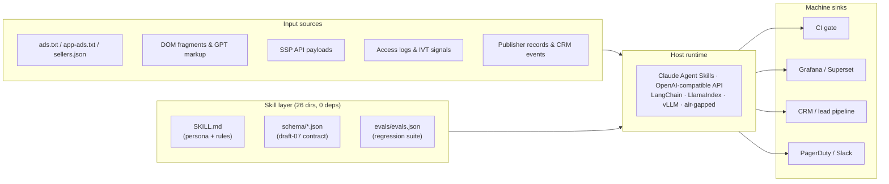
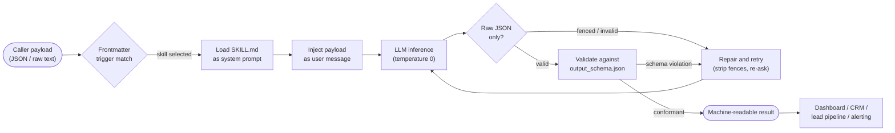
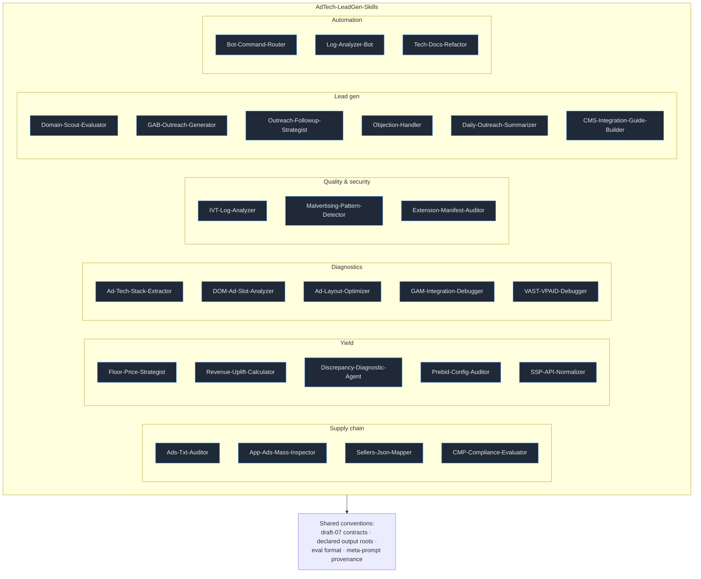

# AdTech-LeadGen-Skills

**Twenty-six schema-validated Agent Skills that turn raw ad-tech telemetry — ads.txt files, DOM fragments, SSP payloads, access logs — into deterministic, machine-consumable output, with zero runtime dependencies and zero vendor lock-in.**

[](LICENSE)
[](#features)
[](#coverage-matrix)
[](#coverage-matrix)
[](#core-technologies)
[](#core-technologies)
[](#linters--formatting-gates)
[](CONTRIBUTING.md)
[](#support-the-project)

`AdTech-LeadGen-Skills` is a curated monorepo of autonomous, machine-to-machine (M2M) **Agent Skills** for programmatic advertising, publisher monetization, and AdOps lead generation. Each skill is a self-contained directory that packages a deterministic system prompt (`SKILL.md`), a formal input/output contract (JSON Schema `draft-07`), a regression eval suite (`evals/evals.json`), and the originating generator prompt (`meta-prompt.md`).

The library is **runtime-agnostic**: it ships no compiled code and no package manifest, which means the exact same assets run unchanged inside Claude Code / Claude Desktop Agent Skills, ChatGPT projects and custom instructions, LangChain or LlamaIndex pipelines, a vLLM/Ollama server, or any OpenAI-compatible HTTP endpoint you already operate.

> [!NOTE]
> Every skill is engineered around a **declared output contract**. Twenty-four skills return a single raw JSON object or array — never prose, never markdown fences, never emojis — so responses are directly consumable by CI jobs, dashboards, CRMs, and lead-generation pipelines without parsing heuristics. Two skills intentionally return plain-text payloads (`CMS-Integration-Guide-Builder` emits Markdown, `Daily-Outreach-Summarizer` emits a human report); both contracts are still schema-declared and assertion-tested.

> [!IMPORTANT]
> This repository contains **prompt assets, schemas, and eval definitions** — not an executable application. "Installation" means placing skill directories where your agent runtime can discover them; "testing" means validating the JSON contracts statically and replaying the bundled eval suites against a model of your choice; "deployment" means versioning and distributing immutable prompt bundles.

> [!TIP]
> Reading this README for the first time? Jump to [Getting Started](#getting-started), then run the static validation block in [Static Contract Validation (Unit)](#static-contract-validation-unit). It proves the entire corpus is intact before you spend a single token on inference.

---

## Table of Contents

- [Features](#features)
  - [Skill Families](#skill-families)
  - [Full Skill Catalog](#full-skill-catalog)
  - [Core Capabilities](#core-capabilities)
- [Tech Stack & Architecture](#tech-stack--architecture)
  - [Core Technologies](#core-technologies)
  - [Runtime Topology](#runtime-topology)
  - [Project Structure](#project-structure)
  - [Per-Skill Anatomy](#per-skill-anatomy)
  - [Key Design Decisions](#key-design-decisions)
  - [Request Lifecycle](#request-lifecycle)
- [Getting Started](#getting-started)
  - [Prerequisites](#prerequisites)
  - [Installation](#installation)
  - [Troubleshooting](#troubleshooting)
- [Testing](#testing)
  - [Static Contract Validation (Unit)](#static-contract-validation-unit)
  - [Behavioral Eval Harness (Integration)](#behavioral-eval-harness-integration)
  - [Linters & Formatting Gates](#linters--formatting-gates)
  - [Coverage Matrix](#coverage-matrix)
- [Deployment](#deployment)
  - [Build & Packaging](#build--packaging)
  - [Containerization](#containerization)
  - [CI/CD Pipeline](#cicd-pipeline)
  - [Production Hardening](#production-hardening)
- [Usage](#usage)
  - [Basic Usage](#basic-usage)
  - [Advanced Usage](#advanced-usage)
  - [Custom Formatters](#custom-formatters)
  - [Edge Cases](#edge-cases)
- [Configuration](#configuration)
  - [Environment Variables](#environment-variables)
  - [Startup Flags](#startup-flags)
  - [Configuration File](#configuration-file)
  - [Precedence & Profiles](#precedence--profiles)
- [License](#license)
- [Contacts & Community Support](#contacts--community-support)

---

## Features

**One contract, twenty-six specialists.** Every skill obeys the same five-file convention, the same draft-07 schema discipline, and the same machine-first serialization rules. Learn one, and you can operate all of them.

### Skill Families

| Family | Skills | Operating question it answers |
|---|---|---|
| **Supply chain & compliance** | `Ads-Txt-Auditor`, `App-Ads-Mass-Inspector`, `Sellers-Json-Mapper`, `CMP-Compliance-Evaluator` | Is this publisher's authorization and consent chain legal, complete, and machine-verifiable? |
| **Yield & monetization** | `Floor-Price-Strategist`, `Revenue-Uplift-Calculator`, `Discrepancy-Diagnostic-Agent`, `Prebid-Config-Auditor`, `SSP-API-Normalizer` | Where is revenue leaking, and what is the defensible next configuration change? |
| **Tag & page diagnostics** | `Ad-Tech-Stack-Extractor`, `DOM-Ad-Slot-Analyzer`, `Ad-Layout-Optimizer`, `GAM-Integration-Debugger`, `VAST-VPAID-Debugger` | Why is this slot blank, slow, non-viewable, or badly integrated? |
| **Traffic quality & security** | `IVT-Log-Analyzer`, `Malvertising-Pattern-Detector`, `Extension-Manifest-Auditor` | Is this traffic or creative hostile, and how severe is the exposure? |
| **Lead generation & outreach** | `Domain-Scout-Evaluator`, `GAB-Outreach-Generator`, `Outreach-Followup-Strategist`, `Objection-Handler`, `Daily-Outreach-Summarizer`, `CMS-Integration-Guide-Builder` | Which publishers should enter the pipeline, what do we send them, and how do we onboard them? |
| **AdOps automation & content** | `Bot-Command-Router`, `Log-Analyzer-Bot`, `Tech-Docs-Refactor` | How do we route natural language to actions and keep operational prose professional? |

### Full Skill Catalog

<details>
<summary><b>Expand the full 26-skill catalog with contract roots</b></summary>

| Skill | Function | Input root | Output root |
|---|---|---|---|
| `Ad-Layout-Optimizer` | Viewability and Better Ads diagnostics per device and slot set | `object` | `object` (`viewability_score_estimate` ∈ Low/Medium/High) |
| `Ad-Tech-Stack-Extractor` | Fingerprints ad servers, wrappers, SSP adapters, content recommendation vendors | `object{source}` | `object` (4 arrays + `confidence_score` 0–100) |
| `Ads-Txt-Auditor` | Line-by-line IAB `ads.txt` v1.1 audit with GAB verification | `object{ads_txt_content}` | `array` of findings; `[]` when compliant |
| `App-Ads-Mass-Inspector` | Batch `app-ads.txt` validation with per-record GAB verdict | `array` of developer records | `array` of per-record verdicts |
| `Bot-Command-Router` | Intent classification and parameter extraction for AdOps chat bots | `string` (raw message) | `object` (`intent`, `extracted_parameters`, `confidence`) |
| `CMP-Compliance-Evaluator` | GDPR/CCPA/TCF v2.2 audit from DOM `<head>` plus intercepted requests | `object` | `object` (`risk_severity` ∈ Safe/Warning/Critical) |
| `CMS-Integration-Guide-Builder` | Generates CMS-specific ad integration onboarding guides | `object{cms_platform, publisher_domain}` | `string` (`text/markdown`) |
| `DOM-Ad-Slot-Analyzer` | Maps GPT containers, lazy loading, and viewability blockers | `array` of containers | `object` (`ad_slots_analyzed`, `slots[]`) |
| `Daily-Outreach-Summarizer` | Aggregates sent/open/reply events into a daily report | `array` of events | `string` (plain text, no Markdown) |
| `Discrepancy-Diagnostic-Agent` | Diagnoses GAM-vs-SSP impression gaps | `object` | `object` (`status` ∈ Normal/High/Critical) |
| `Domain-Scout-Evaluator` | Scores publisher domains for GAB eligibility and routing | `object` | `object` (`lead_score`, `pipeline_status`, `projected_ecpm_tier`) |
| `Extension-Manifest-Auditor` | MV3 compliance, deprecated MV2 fields, over-broad permissions, CSP review | `string` (manifest JSON) | `oneOf` AuditResult / `{error}` |
| `Floor-Price-Strategist` | Floor price and UPR recommendations from bid landscape data | `array` of inventory units | `object` (`analysis_summary`, `upr_recommendations[]`) |
| `GAB-Outreach-Generator` | Cold outreach email for GAB partnership, with technical hooks | `object` | `object` (`subject_line`, `email_body`, `technical_hooks_used[]`) |
| `GAM-Integration-Debugger` | Root-causes GPT breakage and returns a code patch | `object` | `object` (`severity` ∈ critical/warning, `suggested_code_fix`) |
| `IVT-Log-Analyzer` | Invalid-traffic and bot detection over access logs | `object{domain, requests[]}` | `object` (`compliance_status` ∈ Approved/Warning/Rejected) |
| `Log-Analyzer-Bot` | Isolates CI/CD failures and prescribes a fix | `object{log}` | `object` (`status` ∈ failed/passed) |
| `Malvertising-Pattern-Detector` | Static threat scan of ad creative JavaScript | `string` (JS source) | `object` (`threat_level` ∈ Safe/Suspicious/Malicious) |
| `Objection-Handler` | Classifies publisher pushback and drafts a counter-response | `object` | `object` (`objection_category` ∈ RPM/Integration/AdSense/Hard_No/Other) |
| `Outreach-Followup-Strategist` | Day-3 / Day-7 sequence follow-ups with new technical value | `object` | `object` (`followup_subject_line`, `followup_body`, `new_technical_value_provided`) |
| `Prebid-Config-Auditor` | Timeout, bidder density, and price-granularity audit | `object` (config) | `object` (`audit_status` ∈ Pass/Needs_Optimization/Critical_Issues) |
| `Revenue-Uplift-Calculator` | RPM and monthly revenue projection for GAB integration | `object` | `object` (`projected_rpm_usd`, `estimated_monthly_revenue_uplift_usd`) |
| `SSP-API-Normalizer` | Normalizes heterogeneous SSP payloads into a unified schema | `object` | `object` (`normalized_data[]`, `data_integrity_warnings[]`) |
| `Sellers-Json-Mapper` | Reconciles `ads.txt` entries against `sellers.json` records | `object` | `object` (`reconciliation_status` ∈ Passed/Failed/Warning) |
| `Tech-Docs-Refactor` | Rewrites technical prose to a professional register | `object{draft}` | `object{markdown}` |
| `VAST-VPAID-Debugger` | Validates VAST XML, wrapper depth, and VPAID API gaps | `string` (XML/JS) | `object` (`tag_type`, `is_valid`, `critical_errors[]`, `latency_warnings[]`) |

</details>

### Core Capabilities

- **Schema-first contracts** — every skill ships `schema/input_schema.json` and `schema/output_schema.json` (JSON Schema `draft-07`), so integration is a typed handshake rather than prompt guesswork. 52 schema documents in total.
- **Strict serialization discipline** — outputs are a single JSON value with no fences, no preamble, no trailing commentary. Empty results are canonical (`[]`, `null`), never prose.
- **Explicit error envelopes** — malformed input is a first-class outcome: `{"error": "Invalid input: <reason>"}` (CMP evaluator), `{"error": "Invalid JSON: <message>"}` (extension auditor), `{"error": "Invalid step. Must be day_3 or day_7."}` (follow-up strategist). Callers can branch on a documented key instead of guessing.
- **Non-hallucination guardrails** — evidence-only reporting is a first-class rule. `Ad-Tech-Stack-Extractor` maintains an explicit exclusion list (GA4, GTM, Segment, Hotjar, Mixpanel, Amplitude, Comscore, Nielsen, …) and returns empty arrays when no ad-tech signal exists.
- **Calibrated confidence and severity** — certainty is data, not commentary: `0–100` integer for stack extraction, `0.0–1.0` float for intent classification, and tiered severities (`critical`/`warning`; `Safe`/`Warning`/`Critical`; `Approved`/`Warning`/`Rejected`) so policy engines can route, alert, or block automatically.
- **Deterministic persona prompts** — each `SKILL.md` declares a senior-domain persona (AdTech Compliance Auditor, Level 3 GAM Support Engineer, Supply Chain Verification Agent, …) plus rule tables and worked examples, eliminating stylistic drift across runs and models.
- **YAML frontmatter trigger contract** — each `SKILL.md` opens with `name` + `description` frontmatter containing explicit trigger phrases, enabling automatic skill discovery and routing by the host runtime.
- **Bundled regression evals** — 80 eval cases and 235 assertions in the standard *skill-creator* format, covering happy paths, syntax failures, duplicates, GAB edge cases, and unknown-intent fallbacks.
- **Batch processing with state isolation** — `App-Ads-Mass-Inspector`, `Floor-Price-Strategist`, and `Daily-Outreach-Summarizer` process record arrays independently, preserving input order and preventing cross-record contamination.
- **Documented edge-case behavior** — empty arrays, unparseable sizes, unknown slot positions, missing geo, malformed JSON, and analytics-only inputs are all specified explicitly (see [Edge Cases](#edge-cases)).
- **Reproducible provenance** — every skill ships its `meta-prompt.md` generator prompt, so any skill can be regenerated, forked, or extended deterministically.
- **Model-agnostic by construction** — Claude Agent Skills, OpenAI-compatible chat completions, local inference servers. No SDK requirement ships with the repo; no vendor lock-in.
- **Zero runtime dependencies** — pure Markdown + JSON. Nothing to compile, nothing to `npm install`, nothing to break at 03:00 on a Saturday.
- **Commercial-friendly licensing** — Apache License 2.0, safe for proprietary and commercial derivative works, with an express patent grant.

---

## Tech Stack & Architecture

### Core Technologies

| Layer | Technology | Role |
|---|---|---|
| Prompt layer | GitHub-Flavored Markdown (GFM) | System prompts, personas, rule tables, worked examples |
| Contract layer | JSON Schema `draft-07` | Typed input/output validation with `enum`, `pattern`, `oneOf`, `additionalProperties: false` |
| Test layer | JSON (skill-creator eval format) | Prompt + assertion regression suites |
| Provenance layer | Markdown (CRLF-authored) | `meta-prompt.md` generator prompts for reproducibility |
| Distribution layer | Git, tarball, container image | Versioning and skill packaging |
| Optional tooling | Node.js ≥ 18, Python ≥ 3.9, `jq` ≥ 1.6 | Schema compilation, eval execution, JSON linting |
| Optional tooling | `markdownlint-cli2`, `prettier`, `ajv-cli` | Documentation and formatting gates in CI |

> [!TIP]
> There is **no application runtime** in this repository. The "tech stack" is deliberately a *documentation-as-configuration* stack: Markdown prompts are the executable surface, and JSON Schema is the type system. That is precisely what makes the library portable across every major agent runtime — and auditable by security review without a dependency tree.

### Runtime Topology



### Project Structure

```text
AdTech-LeadGen-agent-skills/
├── .markdownlint.json                 # Lint policy tuned for GitHub alerts + <details>
├── README.md                          # This document
├── LICENSE                            # Apache License 2.0
├── CONTRIBUTING.md                    # Contribution workflow
├── CODE_OF_CONDUCT.md                 # Community standards
├── SECURITY.md                        # Responsible disclosure policy
└── <Skill-Name>/                      # 26 skill directories, identical anatomy
    ├── SKILL.md                       # Runtime system prompt
    ├── meta-prompt.md                 # Generator prompt (CRLF)
    ├── schema/
    │   ├── input_schema.json          # Request contract
    │   └── output_schema.json         # Response contract
    └── evals/
        └── evals.json                 # Regression cases + assertions
```

<details>
<summary><b>Expand the full repository tree</b> (26 skills · 136 tracked files · 52 schema documents)</summary>

```text
AdTech-LeadGen-agent-skills/
├── Ad-Layout-Optimizer/               # 202 lines — viewability & Better Ads diagnostics
│   ├── SKILL.md
│   ├── meta-prompt.md
│   ├── evals/evals.json               # 3 cases / 6 assertions
│   └── schema/{input,output}_schema.json
│
├── Ad-Tech-Stack-Extractor/           # 232 lines — programmatic stack fingerprinting
│   ├── SKILL.md
│   ├── meta-prompt.md
│   ├── evals/evals.json               # 3 cases / 7 assertions
│   └── schema/{input,output}_schema.json
│
├── Ads-Txt-Auditor/                   # 268 lines — IAB ads.txt v1.1 auditor
│   ├── SKILL.md
│   ├── meta-prompt.md
│   ├── evals/evals.json               # 4 cases / 5 assertions
│   └── schema/{input,output}_schema.json
│
├── App-Ads-Mass-Inspector/            # 268 lines — batch app-ads.txt validation
│   ├── SKILL.md
│   ├── meta-prompt.md
│   ├── evals/evals.json               # 3 cases / 13 assertions
│   └── schema/{input,output}_schema.json
│
├── Bot-Command-Router/                # 155 lines — NLP intent router
│   ├── SKILL.md
│   ├── meta-prompt.md
│   ├── evals/evals.json               # 4 cases / 8 assertions
│   └── schema/{input,output}_schema.json
│
├── CMP-Compliance-Evaluator/          # 242 lines — GDPR/CCPA/TCF v2.2 auditor
│   ├── SKILL.md
│   ├── meta-prompt.md
│   ├── evals/evals.json               # 3 cases / 17 assertions
│   └── schema/{input,output}_schema.json
│
├── CMS-Integration-Guide-Builder/     # 304 lines — CMS-specific onboarding guides
│   ├── SKILL.md
│   ├── meta-prompt.md
│   ├── evals/evals.json               # 3 cases / 16 assertions
│   └── schema/{input,output}_schema.json
│
├── DOM-Ad-Slot-Analyzer/              # 164 lines — GPT container & viewability mapping
│   ├── SKILL.md
│   ├── meta-prompt.md
│   ├── evals/evals.json               # 3 cases / 14 assertions
│   └── schema/{input,output}_schema.json
│
├── Daily-Outreach-Summarizer/         # 185 lines — outreach analytics aggregation
│   ├── SKILL.md
│   ├── meta-prompt.md
│   ├── evals/evals.json               # 2 cases / 7 assertions
│   └── schema/{input,output}_schema.json
│
├── Discrepancy-Diagnostic-Agent/      # 254 lines — GAM vs SSP discrepancy diagnosis
│   ├── SKILL.md
│   ├── meta-prompt.md
│   ├── evals/evals.json               # 3 cases / 12 assertions
│   └── schema/{input,output}_schema.json
│
├── Domain-Scout-Evaluator/            # 219 lines — publisher lead scoring
│   ├── SKILL.md
│   ├── meta-prompt.md
│   ├── evals/evals.json               # 4 cases / 9 assertions
│   └── schema/{input,output}_schema.json
│
├── Extension-Manifest-Auditor/        # 205 lines — Chrome MV3 compliance review
│   ├── SKILL.md
│   ├── meta-prompt.md
│   ├── evals/evals.json               # 3 cases / 7 assertions
│   └── schema/{input,output}_schema.json
│
├── Floor-Price-Strategist/            # 232 lines — floor price & UPR strategy
│   ├── SKILL.md
│   ├── meta-prompt.md
│   ├── evals/evals.json               # 3 cases / 6 assertions
│   └── schema/{input,output}_schema.json
│
├── GAB-Outreach-Generator/            # 208 lines — GAB cold outreach copy
│   ├── SKILL.md
│   ├── meta-prompt.md
│   ├── evals/evals.json               # 3 cases / 8 assertions
│   └── schema/{input,output}_schema.json
│
├── GAM-Integration-Debugger/          # 192 lines — GPT breakage root-cause + patch
│   ├── SKILL.md
│   ├── meta-prompt.md
│   ├── evals/evals.json               # 3 cases / 7 assertions
│   └── schema/{input,output}_schema.json
│
├── IVT-Log-Analyzer/                  # 271 lines — invalid traffic & bot detection
│   ├── SKILL.md
│   ├── meta-prompt.md
│   ├── evals/evals.json               # 3 cases / 13 assertions
│   └── schema/{input,output}_schema.json
│
├── Log-Analyzer-Bot/                  # 168 lines — CI/CD failure isolation
│   ├── SKILL.md
│   ├── meta-prompt.md
│   ├── evals/evals.json               # 3 cases / 8 assertions
│   └── schema/{input,output}_schema.json
│
├── Malvertising-Pattern-Detector/     # 232 lines — ad creative threat scan
│   ├── SKILL.md
│   ├── meta-prompt.md
│   ├── evals/evals.json               # 3 cases / 8 assertions
│   └── schema/{input,output}_schema.json
│
├── Objection-Handler/                 # 168 lines — publisher objection responses
│   ├── SKILL.md
│   ├── meta-prompt.md
│   ├── evals/evals.json               # 4 cases / 9 assertions
│   └── schema/{input,output}_schema.json
│
├── Outreach-Followup-Strategist/      # 183 lines — Day-3 / Day-7 follow-ups
│   ├── SKILL.md
│   ├── meta-prompt.md
│   ├── evals/evals.json               # 2 cases / 6 assertions
│   └── schema/{input,output}_schema.json
│
├── Prebid-Config-Auditor/             # 232 lines — header bidding config audit
│   ├── SKILL.md
│   ├── meta-prompt.md
│   ├── evals/evals.json               # 3 cases / 6 assertions
│   └── schema/{input,output}_schema.json
│
├── Revenue-Uplift-Calculator/         # 182 lines — RPM / revenue projection
│   ├── SKILL.md
│   ├── meta-prompt.md
│   ├── evals/evals.json               # 3 cases / 10 assertions
│   └── schema/{input,output}_schema.json
│
├── SSP-API-Normalizer/                # 277 lines — unified SSP schema mapping
│   ├── SKILL.md
│   ├── meta-prompt.md
│   ├── evals/evals.json               # 3 cases / 0 assertions (see note)
│   └── schema/{input,output}_schema.json
│
├── Sellers-Json-Mapper/               # 191 lines — ads.txt ↔ sellers.json reconciliation
│   ├── SKILL.md
│   ├── meta-prompt.md
│   ├── evals/evals.json               # 3 cases / 7 assertions
│   └── schema/{input,output}_schema.json
│
├── Tech-Docs-Refactor/                # 128 lines — technical prose refactoring
│   ├── SKILL.md
│   ├── meta-prompt.md
│   ├── evals/evals.json               # 3 cases / 11 assertions
│   └── schema/{input,output}_schema.json
│
└── VAST-VPAID-Debugger/               # 268 lines — VAST/VPAID validation
    ├── SKILL.md
    ├── meta-prompt.md
    ├── evals/evals.json               # 3 cases / 15 assertions
    └── schema/{input,output}_schema.json
```

</details>

### Per-Skill Anatomy

Every skill directory follows an identical five-file convention. This is a hard invariant: tooling and contribution review both depend on it.

```text
<Skill-Name>/
├── SKILL.md                  # Runtime system prompt: frontmatter, persona, rules, logic, examples
├── schema/
│   ├── input_schema.json     # Draft-07 contract for the request payload
│   └── output_schema.json    # Draft-07 contract for the response payload
├── evals/
│   └── evals.json            # { skill_name, evals: [{ id, prompt, expected_output, files, assertions }] }
└── meta-prompt.md            # Generator prompt that produced this skill (provenance)
```

| Artifact | Consumed by | Changed when |
|---|---|---|
| `SKILL.md` | The model, at inference time | Behavior, rules, or scoring logic changes |
| `schema/*.json` | Caller, gateway, CI | Contract changes (breaking → major version) |
| `evals/evals.json` | Test harness | New regression discovered or behavior tightened |
| `meta-prompt.md` | Maintainers | The skill is regenerated from scratch |

> [!NOTE]
> Directory names are PascalCase or hyphenated (`Ads-Txt-Auditor`), while the YAML frontmatter `name:` value is inconsistently cased across the corpus — some skills use `Ads-Txt-Auditor`, others `ads-txt-auditor`. Directory names are the stable identifier: use them for filesystem discovery, `--skill` flags, and container mounts. Treat frontmatter `name` as display metadata only.

### Key Design Decisions

<details>
<summary><b>Expand architectural rationale (8 decisions, 2 diagrams)</b></summary>

**1. One directory per skill (Agent Skills convention).**
Each skill is a self-contained, relocatable unit. Dropping a directory into `~/.claude/skills/`, a ChatGPT project, or a Docker image is the entire "integration" step. There is no registry to update and no manifest to reconcile.

**2. Contracts before prompts (schema-first).**
The JSON Schema pair is authored first and treated as the source of truth. The `SKILL.md` prompt is then written to satisfy that contract exactly, including `additionalProperties: false` on both sides. This prevents the most common failure mode of prompt engineering: silent schema drift.

**3. Frontmatter as a routing contract.**
`name` + `description` YAML frontmatter carries the trigger vocabulary ("check ads.txt", "detect Prebid", "verify TCF v2.2", …). Host runtimes use this metadata for automatic skill selection, so the routing surface is declarative rather than hard-coded.

**4. Separation of the four concerns.**

| Artifact | Concern | Consumer |
|---|---|---|
| `SKILL.md` | Runtime behavior (persona, rules, logic) | LLM at inference time |
| `schema/*.json` | Type safety and validation | Caller / CI / gateway |
| `evals/evals.json` | Regression behavior over time | Test harness |
| `meta-prompt.md` | Provenance and regeneration | Maintainers |

**5. Evidence-only (non-hallucination) architecture.**
Rather than relying on the model to "be careful", each skill encodes an explicit detection table plus a deny-list, and defines the *correct* empty output (`[]`, `null`, `confidence_score: 0`). Absence of evidence becomes a first-class, specifiable result.

**6. Serialization contract matched to the consumer.**
Machine consumers get raw JSON, so the contract forbids fences and prose. Where a human is the consumer — onboarding guides, daily reports — the skill returns Markdown or plain text instead of hiding a document inside a JSON string. In both cases the shape is declared in schema and asserted in evals.

**7. Scoring as part of the payload.**
Confidence, severity, and pipeline status are returned as data, not commentary, so callers implement policy (`severity == "Critical"`, `pipeline_status == "approved"`) without re-parsing natural language.

**8. Zero-dependency portability.**
By refusing to introduce a runtime, package manager, or build tool, the library stays usable from any language and any deployment target — including air-gapped environments where skill files are mounted as configuration.

**Request → response pipeline:**



**Monorepo composition:**



</details>

### Request Lifecycle

The invocation contract is always the same three steps, regardless of runtime or provider:

1. **Load** `SKILL.md` as the system prompt (verbatim, including frontmatter).
2. **Send** the payload as the user message. Never wrap it in additional instructions unless the skill explicitly permits it.
3. **Parse** the response according to the declared output root, then validate it against `schema/output_schema.json`.

> [!WARNING]
> Do not "help" the model by adding instructions such as "return JSON" or "explain your reasoning". Every `SKILL.md` already encodes the output contract; extra instructions are the most common cause of schema violations and fenced output.

---

## Getting Started

### Prerequisites

| Requirement | Version | Purpose | Required? |
|---|---|---|---|
| `git` | ≥ 2.30 | Clone the repository | ✅ Yes |
| An LLM runtime | — | Claude Code / Claude Desktop (Agent Skills), ChatGPT, or any chat-completions endpoint | ✅ Yes |
| `jq` | ≥ 1.6 | Inspect and validate JSON assets | ⬜ Optional |
| Node.js | ≥ 18 | Schema compilation (`ajv-cli`), linting (`markdownlint-cli2`, `prettier`) | ⬜ Optional |
| Python | ≥ 3.9 | Reference eval harness (`jsonschema`, provider SDK) | ⬜ Optional |
| Docker | ≥ 24 | Containerized skill-serving API | ⬜ Optional |

You will also need an API key for the model provider you target (`ANTHROPIC_API_KEY`, `OPENAI_API_KEY`, or a local endpoint). Never commit credentials — see [Configuration](#configuration).

> [!CAUTION]
> Several skills process untrusted third-party content (pasted HTML, ad JavaScript, VAST XML, access logs). Treat every payload as hostile: do not execute it, do not interpolate it into shell commands, and prefer running the skill inside a sandboxed process with no filesystem write access.

### Installation

**1. Clone the repository**

```bash
git clone https://github.com/adops-tool/AdTech-LeadGen-agent-skills.git
cd AdTech-LeadGen-agent-skills
```

**2. Verify the asset inventory**

```bash
# Every JSON asset must parse
find . -path ./.git -prune -o -name '*.json' -print | while read -r f; do
  jq empty "$f" || echo "FAIL $f"
done

# Count the corpus (expected: 26 skills, 52 schema files)
ls -d */ | wc -l
ls */schema/*.json | wc -l
```

**3. Install into your agent runtime**

*Claude Code / Claude Desktop (Agent Skills):*

```bash
# Install the complete catalog
mkdir -p ~/.claude/skills
cp -R ./*/ ~/.claude/skills/

# Or install only what you need
cp -R Ads-Txt-Auditor Sellers-Json-Mapper ~/.claude/skills/
```

*Any LLM API (manual wiring):*

```bash
# SKILL.md *is* the system prompt — no build step, no transpilation
head -20 Ads-Txt-Auditor/SKILL.md    # sanity check: frontmatter, persona, rules
```

> [!TIP]
> Skills are discovered by their YAML frontmatter. If a skill does not appear in your runtime, confirm that `SKILL.md` begins with the opening `---` fence on line 1 and that both `name:` and `description:` keys are present.

<details>
<summary><b>Alternative installation methods and build-from-source validation</b></summary>

**Install a single skill via sparse checkout (minimal footprint)**

```bash
git clone --filter=blob:none --no-checkout https://github.com/adops-tool/AdTech-LeadGen-agent-skills.git
cd AdTech-LeadGen-agent-skills
git sparse-checkout init --cone
git sparse-checkout set Ads-Txt-Auditor
git checkout main
```

**Install from a release tarball (air-gapped environments)**

```bash
curl -fsSL -o skills.tar.gz \
  https://github.com/adops-tool/AdTech-LeadGen-agent-skills/archive/refs/heads/main.tar.gz
tar -xzf skills.tar.gz
cp -R AdTech-LeadGen-agent-skills-main/Ads-Txt-Auditor ~/.claude/skills/
```

**Pin the corpus as a submodule (reproducible agent builds)**

```bash
git submodule add -b main \
  https://github.com/adops-tool/AdTech-LeadGen-agent-skills.git skills
git -C skills checkout v1.0.0     # always pin a tag in production
```

**"Building from source" — validation and packaging**

Because the library ships no compiled code, the build step is a verification and packaging pass:

```bash
# 1. Install optional tooling
npm install --global markdownlint-cli2 prettier ajv-cli
pip install jsonschema

# 2. Compile every JSON Schema document
for f in */schema/*.json; do
  npx ajv compile --strict=false -s "$f" >/dev/null && echo "COMPILED  $f"
done

# 3. Package one distributable bundle per skill
mkdir -p dist
for d in */; do
  name=$(basename "$d")
  tar -czf "dist/${name}.tar.gz" "$name"
done
sha256sum dist/*.tar.gz | tee dist/SHA256SUMS
```

</details>

### Troubleshooting

| Symptom | Likely cause | Fix |
|---|---|---|
| Skill not discovered by the runtime | Frontmatter missing or directory outside the skills path | Verify `~/.claude/skills/<Skill-Name>/SKILL.md` exists and starts with `---` on line 1 |
| `jq: error ... Invalid literal` | BOM, trailing comma, or smart quotes introduced by an editor | Re-save as UTF-8 without BOM; run `npx prettier --write "**/*.json"` |
| Model returns markdown-fenced JSON | Prompt truncated, temperature too high, or extra instructions injected | Set `temperature = 0`, raise `max_tokens`, enable fence stripping in the client |
| `ajv` rejects a schema in strict mode | Non-standard annotation keywords (`notes`, `examples`, `format: "uri"`) | Compile with `--strict=false` (see [Static Contract Validation](#static-contract-validation-unit)) |
| Lint failures on `meta-prompt.md` | Those files are authored with CRLF line endings by design | Normalize with `sed -i 's/\r$//' */meta-prompt.md`, or ignore them |
| Eval assertions fail intermittently | Non-deterministic decoding or a floating model version | Pin `temperature = 0` and an explicit model ID in the harness |
| Windows checkout shows `^M` | Git `core.autocrlf` conversion on checkout | `git config --global core.autocrlf input` and re-clone |
| Claude Skill truncated at load | Prompt exceeds the runtime's system-prompt budget | Split the skill, or move worked examples behind a retrieval step |

> [!TIP]
> `scripts/run_evals.py` failures, when they appear, are almost always provider-side: expired keys, quota exhaustion, or a model ID that no longer exists. Run one skill in isolation with `--skill` and `--log-level debug` before concluding the prompt regressed.

---

## Testing

The test strategy mirrors the repository's layered architecture: **static contract validation** (unit), **behavioral evals** (integration), and **formatting gates** (linters). None of the three requires the other two to have run first.

### Static Contract Validation (Unit)

```bash
# 1. Parse-check every JSON asset (52 schemas + 26 eval suites)
find . -path ./.git -prune -o -name '*.json' -print | while read -r f; do
  jq empty "$f" && echo "PASS  $f" || echo "FAIL  $f"
done

# 2. Compile every JSON Schema document
for f in */schema/*.json; do
  npx ajv compile --strict=false -s "$f" >/dev/null && echo "COMPILED  $f"
done

# 3. Structural checks on eval suites
jq -e '.skill_name and (.evals | length > 0)' */evals/evals.json >/dev/null

# 4. Frontmatter sanity for every skill
for f in */SKILL.md; do
  head -1 "$f" | grep -q '^---$' && echo "FRONTMATTER OK  $f"
done
```

Expected result: all 79 JSON documents parse (52 schemas, 26 eval suites, 1 lint config), all 52 schemas compile, all 26 frontmatter blocks validate.

> [!NOTE]
> `ajv` must be invoked with `--strict=false`. Several schemas use **non-standard annotation keywords** that draft-07 permits (unknown keywords are ignored by spec) but that ajv's default strict mode rejects: `notes` and `examples` at the schema root, `constraints` blocks in the outreach skills, and `"format": "uri"` in `CMP-Compliance-Evaluator/schema/input_schema.json` (formats are advisory annotations in draft-07 unless a format plugin such as `ajv-formats` is registered). This is intentional documentation metadata, not a schema defect.

> [!IMPORTANT]
> All schemas are genuinely **draft-07**, including numeric `exclusiveMinimum` (`{"exclusiveMinimum": 0}`, not the draft-04 boolean form `{"minimum": 0, "exclusiveMinimum": true}`). The draft-04 form is rejected by `ajv` and ignored by draft-07 validators, which silently turns a strictly-positive bound into an unbounded one. If you add schemas, copy an existing file rather than writing keywords from memory.

> [!TIP]
> Run the same four commands in a pre-commit hook. They complete in under two seconds on the full corpus, catch 90% of contribution errors, and cost no tokens.

### Behavioral Eval Harness (Integration)

Each skill ships an `evals/evals.json` suite in the standard *skill-creator* format:

```json
{
  "skill_name": "Ads-Txt-Auditor",
  "evals": [
    {
      "id": 1,
      "prompt": "Audit this ads.txt file and return a JSON array of compliance errors: ...",
      "expected_output": "[]",
      "files": [],
      "assertions": ["output == []"]
    }
  ]
}
```

Inspect a suite without executing anything:

```bash
# List cases and assertions for one skill
jq '.evals[] | {id, assertions}' Ads-Txt-Auditor/evals/evals.json

# Total coverage across the corpus
jq -s '[.[].evals | length] | add' */evals/evals.json        # 80
jq -s '[.[].evals[].assertions | length] | add' */evals/evals.json   # 235
```

<details>
<summary><b>Reference eval harness (<code>scripts/run_evals.py</code>)</b></summary>

The repository ships the eval *definitions*; the harness below is a reference implementation you add yourself at `scripts/run_evals.py`. It executes the suites against the provider of your choice. It loads `SKILL.md` as the system prompt, replays each case, validates the response against `schema/output_schema.json`, then evaluates the suite's string assertions as a secondary, human-readable signal.

```python
#!/usr/bin/env python3
"""Reference eval harness for AdTech-LeadGen-Skills.

Usage:
    python3 scripts/run_evals.py --all
    python3 scripts/run_evals.py --skill Ads-Txt-Auditor --model claude-sonnet-4-5
"""
from __future__ import annotations

import argparse
import json
import re
import sys
from pathlib import Path

from anthropic import Anthropic            # pip install anthropic jsonschema
from jsonschema import Draft7Validator

ROOT = Path(__file__).resolve().parent.parent
DEFAULT_MODEL = "claude-sonnet-4-5"
FENCE = "`" * 3                            # built dynamically: literal fences inside
                                           # fenced blocks are fragile to copy/paste


def strip_fences(text: str) -> str:
    """Defensive repair: remove accidental markdown fences around JSON output."""
    pattern = rf"^{FENCE}(?:json)?|{FENCE}$"
    return re.sub(pattern, "", text.strip(), flags=re.MULTILINE).strip()


def load_skill(skill_dir: Path) -> tuple[str, dict]:
    system_prompt = (skill_dir / "SKILL.md").read_text(encoding="utf-8")
    output_schema = json.loads((skill_dir / "schema" / "output_schema.json").read_text())
    return system_prompt, output_schema


def invoke(client: Anthropic, model: str, system_prompt: str, prompt: str) -> str:
    message = client.messages.create(
        model=model,
        max_tokens=2048,
        temperature=0.0,                   # deterministic decoding for reproducible evals
        system=system_prompt,
        messages=[{"role": "user", "content": prompt}],
    )
    return strip_fences("".join(b.text for b in message.content if b.type == "text"))


def eval_expression(assertion: str, payload) -> bool:
    """Best-effort evaluation of simple '<path> == <value>' assertions."""
    if "==" not in assertion:
        return False
    path, expected = (part.strip() for part in assertion.split("==", 1))
    node = payload
    try:
        for part in path.split("."):
            node = node[int(part)] if isinstance(node, list) else node[part]
    except (KeyError, IndexError, ValueError, TypeError):
        return False
    return str(node).strip("'\"") == expected.strip("'\"")


def evaluate(skill: str, model: str) -> int:
    skill_dir = ROOT / skill
    system_prompt, output_schema = load_skill(skill_dir)
    suite = json.loads((skill_dir / "evals" / "evals.json").read_text())
    client = Anthropic()                   # reads ANTHROPIC_API_KEY from the environment

    failures = 0
    for case in suite["evals"]:
        raw = invoke(client, model, system_prompt, case["prompt"])
        try:
            payload = json.loads(raw)
        except json.JSONDecodeError as exc:
            print(f"  [FAIL] {skill} #{case['id']}: invalid JSON ({exc})")
            failures += 1
            continue

        # Contract gate: the response must satisfy the published output schema.
        errors = sorted(Draft7Validator(output_schema).iter_errors(payload), key=str)
        if errors:
            print(f"  [FAIL] {skill} #{case['id']}: schema violation: {errors[0].message}")
            failures += 1
            continue

        blob = json.dumps(payload)
        for assertion in case["assertions"]:
            ok = assertion.lower() in blob.lower() or eval_expression(assertion, payload)
            print(f"  [{'PASS' if ok else 'FAIL'}] {skill} #{case['id']}: {assertion}")
            failures += 0 if ok else 1

    print(f"{skill}: {len(suite['evals'])} case(s), {failures} failure(s)")
    return failures


if __name__ == "__main__":
    parser = argparse.ArgumentParser()
    parser.add_argument("--skill")
    parser.add_argument("--all", action="store_true")
    parser.add_argument("--model", default=DEFAULT_MODEL)
    args = parser.parse_args()

    skills = sorted(p.name for p in ROOT.iterdir() if (p / "SKILL.md").exists())
    targets = skills if args.all else [args.skill]
    sys.exit(1 if sum(evaluate(s, args.model) for s in targets) else 0)
```

```bash
pip install anthropic jsonschema
export ANTHROPIC_API_KEY="sk-ant-..."
python3 scripts/run_evals.py --all
```

> [!NOTE]
> The `(gam - ssp) / gam`-style numeric assertions in text form are evaluated by the string-matching branch; treat a `[FAIL]` on a numeric comparison as a signal to inspect the payload manually rather than as an automatic defect.

</details>

> [!IMPORTANT]
> Eval suites are **behavioral**, not hermetic. The same prompt can produce different JSON across model versions. Pin the model ID and `temperature = 0` in CI, and triage assertion failures as prompt-regression signals — not automatically as code bugs.

### Linters & Formatting Gates

```bash
# Markdown lint — CI gate (see scope note below)
npx markdownlint-cli2 "README.md"

# JSON formatting — run on changed files only
npx prettier --check "**/*.json"

# YAML frontmatter sanity for every SKILL.md
for f in */SKILL.md; do
  head -1 "$f" | grep -q '^---$' && echo "FRONTMATTER OK  $f"
done
```

> [!NOTE]
> `.markdownlint.json` deliberately disables the rules incompatible with this documentation style: `MD013` (80-char line limit — badge rows and wide reference tables legitimately exceed it), `MD033` (restricted to `details`/`summary`/`b`/`code` for collapsible blocks), `MD036` (bold pseudo-headings), `MD028` (consecutive GitHub alert blockquotes), and `MD060` (compact table pipe style). Everything else runs at full strictness.

> [!WARNING]
> **Known pre-existing formatting debt (not a regression).** At the time of writing, `markdownlint-cli2 "*/SKILL.md"` reports 333 findings across 22 of the 26 skill prompts — `MD031` (blank lines around fences, 166), `MD032` (blank lines around lists, 57), `MD040` (missing fence language, 48), `MD022` (blank lines around headings, 47), `MD024` (duplicate headings, 10), and `MD033` (inline HTML, 5). `prettier --check` reports drift in 35 of the 78 JSON assets. The CI gate is therefore scoped to `README.md` plus files touched by a pull request. Normalizing the historical corpus is a separate mechanical pass (`npx markdownlint-cli2 --fix`, `npx prettier --write`) and should land in its own PR so the diff stays reviewable.

> [!CAUTION]
> `*/meta-prompt.md` files are authored with **CRLF** line endings and will trip strict Markdown linters out of the box. Normalize them (`sed -i 's/\r$//' */meta-prompt.md`) or exclude them via `.markdownlintignore`. Do not change line endings inside a feature PR without calling it out in the description.

> [!NOTE]
> `SSP-API-Normalizer/evals/evals.json` currently contains three cases with empty assertion arrays. The cases still exercise the output schema gate, but they contribute zero behavioral assertions. Adding assertions there is a good first contribution.

### Coverage Matrix

<details>
<summary><b>Expand per-skill eval coverage</b> (80 cases · 235 assertions)</summary>

| Skill | Cases | Assertions | Notable coverage |
|---|---:|---:|---|
| `Ad-Layout-Optimizer` | 3 | 6 | Better Ads violations, density warnings, sticky recommendations |
| `Ad-Tech-Stack-Extractor` | 3 | 7 | GAM + Prebid detection, APS dual-listing, analytics-only emptiness |
| `Ads-Txt-Auditor` | 4 | 5 | Compliant `[]`, syntax error, GAB error, duplicate entry |
| `App-Ads-Mass-Inspector` | 3 | 13 | Valid record, delimiter error, GAB relationship error |
| `Bot-Command-Router` | 4 | 8 | Three intents plus unknown-command fallback |
| `CMP-Compliance-Evaluator` | 3 | 17 | Compliant CMP, missing CMP, consent-string absence |
| `CMS-Integration-Guide-Builder` | 3 | 16 | WordPress, Next.js, plain HTML guide structure |
| `DOM-Ad-Slot-Analyzer` | 3 | 14 | GPT naming, `display:none`, lazy loading |
| `Daily-Outreach-Summarizer` | 2 | 7 | Report formatting, zero-reply edge case |
| `Discrepancy-Diagnostic-Agent` | 3 | 12 | Normal, critical video gap, Prebid-latency case |
| `Domain-Scout-Evaluator` | 4 | 9 | Tier-1 approval, hard rejection gates, manual review |
| `Extension-Manifest-Auditor` | 3 | 7 | MV2 migration, broad host permissions, clean MV3 |
| `Floor-Price-Strategist` | 3 | 6 | Floor raise, floor reduction, multi-unit UPR output |
| `GAB-Outreach-Generator` | 3 | 8 | Anti-fluff and anti-emoji assertions |
| `GAM-Integration-Debugger` | 3 | 7 | `enableServices` ordering, div ID mismatch, async rendering |
| `IVT-Log-Analyzer` | 3 | 13 | Clean traffic, datacenter/headless, interval bot |
| `Log-Analyzer-Bot` | 3 | 8 | flake8 failure, CodeQL secret, npm module error |
| `Malvertising-Pattern-Detector` | 3 | 8 | Safe, malicious iframe, base64 obfuscation |
| `Objection-Handler` | 4 | 9 | AdSense, integration, RPM, hard-no silence |
| `Outreach-Followup-Strategist` | 2 | 6 | Day-3 and Day-7 value statements |
| `Prebid-Config-Auditor` | 3 | 6 | Slow timeout, aggressive timeout, passing config |
| `Revenue-Uplift-Calculator` | 3 | 10 | Tier-1 uplift, Tier-3 floor, multi-point rationale |
| `SSP-API-Normalizer` | 3 | 0 | Schema gate only — assertions pending |
| `Sellers-Json-Mapper` | 3 | 7 | Passed, failed mismatch, confidentiality warning |
| `Tech-Docs-Refactor` | 3 | 11 | Marketing-language removal, structure preservation |
| `VAST-VPAID-Debugger` | 3 | 15 | Missing impressions, deep wrapper chain, valid inline |

</details>

---

## Deployment

### Build & Packaging

There is no compilation step. The deployable artifact is the skill directory itself.

```bash
# Produce one bundle per skill; evals stay in the repository
mkdir -p dist
for d in */; do
  name=$(basename "$d")
  tar --exclude="$name/evals" --exclude="$name/meta-prompt.md" \
      -czf "dist/${name}.tar.gz" "$name"
done
sha256sum dist/*.tar.gz | tee dist/SHA256SUMS
```

Distribution targets:

1. **Agent runtime skills directory** — `cp -R <Skill> ~/.claude/skills/` (see [Installation](#installation)).
2. **Container image** — bake skills into an image and run a thin skill-serving API (see [Containerization](#containerization)).
3. **Git submodule or internal registry** — pin a tag for reproducible agent builds.

> [!IMPORTANT]
> Always deploy a **pinned commit or tag**, never a floating branch, into production agent runtimes. Because skills are prompts, an accidental upstream edit to a rule table silently changes production audit behavior — with no compiler and no type checker to stop it.

### Containerization

<details>
<summary><b>Dockerfile, Compose stack, and minimal serving API</b></summary>

A minimal pattern for exposing any skill as an HTTP service. Skill files are mounted read-only; the service injects them as system prompts and enforces the output contract at the edge.

`Dockerfile`

```dockerfile
FROM python:3.12-slim

WORKDIR /app
# Skill assets are copied in as configuration — nothing to compile.
COPY Ads-Txt-Auditor /app/skills/Ads-Txt-Auditor
COPY Sellers-Json-Mapper /app/skills/Sellers-Json-Mapper
COPY server.py /app/server.py

RUN pip install --no-cache-dir fastapi uvicorn anthropic jsonschema

ENV SKILL_ROOT=/app/skills \
    MODEL_ID=claude-sonnet-4-5 \
    TEMPERATURE=0 \
    STRICT_JSON=1 \
    LOG_FORMAT=json \
    LOG_LEVEL=info

EXPOSE 8080
HEALTHCHECK CMD python -c "import urllib.request;urllib.request.urlopen('http://127.0.0.1:8080/healthz')"
CMD ["uvicorn", "server:app", "--host", "0.0.0.0", "--port", "8080"]
```

`docker-compose.yml`

```yaml
services:
  skill-api:
    build: .
    ports:
      - "8080:8080"
    environment:
      ANTHROPIC_API_KEY: ${ANTHROPIC_API_KEY:?err}   # injected from host env or secret store
      SKILL_ROOT: /app/skills
      MODEL_ID: claude-sonnet-4-5
      TEMPERATURE: "0"
      SCHEMA_VALIDATION: both
      REDIS_URL: redis://cache:6379/0
    volumes:
      - ./skills:/app/skills:ro          # update skills without rebuilding the image
    read_only: true
    security_opt:
      - no-new-privileges:true
    depends_on:
      cache:
        condition: service_healthy
    restart: unless-stopped

  cache:
    image: redis:7-alpine
    command: ["redis-server", "--appendonly", "yes"]
    volumes:
      - cache-data:/data
    healthcheck:
      test: ["CMD", "redis-cli", "ping"]
      interval: 10s
      timeout: 3s
      retries: 5

volumes:
  cache-data:
```

```bash
docker compose up --build -d
curl -s http://localhost:8080/audit \
  -H 'Content-Type: application/json' \
  -d '{"skill":"Ads-Txt-Auditor","payload":{"ads_txt_content":"google.com, pub-12345, DIRECT, f08c47fec0942fa0"}}' | jq .
```

</details>

### CI/CD Pipeline

<details>
<summary><b>GitHub Actions workflow: validate, lint, eval, release</b></summary>

`.github/workflows/ci.yml`

```yaml
name: ci

on:
  push:
    branches: [main]
  pull_request:

jobs:
  validate:
    runs-on: ubuntu-latest
    steps:
      - uses: actions/checkout@v4

      - name: Parse-check all JSON assets
        run: |
          find . -path ./.git -prune -o -name '*.json' -print | while read -r f; do
            jq empty "$f" || exit 1
          done

      - name: Compile all JSON Schemas
        run: |
          npm install --global ajv-cli
          # --strict=false: annotation keywords (notes, examples, format) are intentional
          for f in */schema/*.json; do npx ajv compile --strict=false -s "$f"; done

      - name: Verify skill anatomy
        run: |
          for d in */; do
            for f in SKILL.md meta-prompt.md schema/input_schema.json \
                     schema/output_schema.json evals/evals.json; do
              test -f "$d$f" || { echo "missing: $d$f"; exit 1; }
            done
          done

      - name: Lint documentation and changed JSON
        run: |
          npm install --global markdownlint-cli2 prettier
          # Markdown gate is scoped to README.md: the SKILL.md corpus carries
          # pre-existing MD031 debt that would otherwise fail every build.
          npx markdownlint-cli2 "README.md"
          CHANGED=$(git diff --name-only --diff-filter=ACMR \
            "${{ github.event.pull_request.base.sha }}...HEAD" -- '*.json' | tr '\n' ' ')
          if [ -n "$CHANGED" ]; then npx prettier --check $CHANGED; fi

  evals:
    runs-on: ubuntu-latest
    needs: validate
    steps:
      - uses: actions/checkout@v4
      - uses: actions/setup-python@v5
        with:
          python-version: "3.12"
      - run: pip install anthropic jsonschema
      - name: Run behavioral eval suites
        env:
          ANTHROPIC_API_KEY: ${{ secrets.ANTHROPIC_API_KEY }}
        run: python3 scripts/run_evals.py --all --model claude-sonnet-4-5

  release:
    if: startsWith(github.ref, 'refs/tags/v')
    needs: [validate, evals]
    runs-on: ubuntu-latest
    steps:
      - uses: actions/checkout@v4
      - name: Package skill bundles
        run: |
          mkdir -p dist
          for d in */; do
            n=$(basename "$d"); tar -czf "dist/$n.tar.gz" "$n"
          done
          sha256sum dist/*.tar.gz > dist/SHA256SUMS
      - uses: softprops/action-gh-release@v2
        with:
          files: |
            dist/*.tar.gz
            dist/SHA256SUMS
```

> [!WARNING]
> Store provider credentials exclusively as encrypted repository secrets (`Settings → Secrets and variables → Actions`). Never echo, print, or commit them, and prefer short-lived, scoped keys for CI. Forked pull requests do not receive secrets — run the eval job only on `push` or gate it behind an environment approval rule.

</details>

### Production Hardening

> [!IMPORTANT]
> A skill is configuration, not code. Treat it with the same change control you would apply to an ad-serving configuration: reviewed diffs, pinned versions, and a rollback path.

- **Pin by commit SHA or tag.** Record the resolved version in every audit artifact so a finding can be reproduced months later.
- **Checksum the bundle.** Verify `SHA256SUMS` at container start; refuse to serve unverified skills.
- **Mount read-only.** Never let a serving process rewrite `SKILL.md`.
- **Enforce the contract at the edge.** Reject schema-invalid responses before they reach a CRM or billing system.
- **Budget the prompt.** Long `SKILL.md` files with worked examples consume context; cache the system prompt where the provider supports it.
- **Sanitize untrusted payloads.** Never feed logs or HTML directly into a shell, and never log raw consent strings or IP addresses without a retention policy.
- **Rate-limit and cache.** Batch skills (`App-Ads-Mass-Inspector`) are the most expensive; key the cache on `(skill, model, payload hash)`.
- **Track drift.** Re-run the eval suite on every model upgrade; a passing pipeline on `claude-sonnet-4-5` is not evidence about any other model.
- **Disclose vulnerabilities privately.** Prompt injection is a real attack surface here: a hostile payload can attempt to override a skill's rules. Never let skill output trigger privileged actions without a second, deterministic check. Report issues per [`SECURITY.md`](SECURITY.md).

---

## Usage

### Basic Usage

The contract is always the same three steps: **load `SKILL.md` as the system prompt → send the payload as the user message → parse the declared output root.**

**Python (Anthropic Messages API)**

```python
import json
import os

from anthropic import Anthropic

# 1. Read credentials from the environment — never hard-code keys.
client = Anthropic(api_key=os.environ["ANTHROPIC_API_KEY"])

# 2. SKILL.md *is* the system prompt: persona, rules, and output contract.
skill_name = "Ads-Txt-Auditor"
with open(f"{skill_name}/SKILL.md", encoding="utf-8") as fh:
    system_prompt = fh.read()

# 3. Build the payload exactly as the input schema declares it.
ads_txt = """\
# authorized sellers for example.com
google.com, pub-1234567890, DIRECT, f08c47fec0942fa0
rubiconproject.com, 17960, RESELLER, 0bfd66d529a55807
"""

response = client.messages.create(
    model="claude-sonnet-4-5",       # any instruction-following model works
    max_tokens=2048,
    temperature=0.0,                 # audits must be reproducible
    system=system_prompt,            # injected skill behavior
    messages=[{
        "role": "user",
        "content": json.dumps({
            "ads_txt_content": ads_txt,
            "platform_domain": "example.com",
        }),
    }],
)

# 4. The output contract guarantees a raw JSON array — parse directly.
findings = json.loads(response.content[0].text)
print(json.dumps(findings, indent=2))
# []  — the file above is fully compliant
```

**cURL (Anthropic Messages API)**

```bash
SKILL=$(cat Ads-Txt-Auditor/SKILL.md)
PAYLOAD='{"ads_txt_content":"google.com, pub-12345\npubmatic.com, 156209, RESELLER"}'

curl -s https://api.anthropic.com/v1/messages \
  -H "x-api-key: $ANTHROPIC_API_KEY" \
  -H "anthropic-version: 2023-06-01" \
  -H "content-type: application/json" \
  -d "$(jq -n --arg sys "$SKILL" --arg user "$PAYLOAD" '{
        model: "claude-sonnet-4-5",
        max_tokens: 2048,
        temperature: 0,
        system: $sys,
        messages: [{role: "user", content: $user}]
      }')" | jq -r '.content[0].text' | jq .
```

**Node.js (OpenAI-compatible endpoint)**

```javascript
import { readFile } from "node:fs/promises";

// 1. The skill file is portable: the same bytes work on any provider.
const systemPrompt = await readFile("Domain-Scout-Evaluator/SKILL.md", "utf8");

// 2. Payload matches schema/input_schema.json for this skill.
const payload = {
  domain: "example-news.com",
  category: "news",
  monthly_visits: 1200000,
  geo_distribution: { US: 0.52, UK: 0.14, IN: 0.18, other: 0.16 },
  bounce_rate: 0.58,
};

const response = await fetch("https://api.openai.com/v1/chat/completions", {
  method: "POST",
  headers: {
    "content-type": "application/json",
    authorization: `Bearer ${process.env.OPENAI_API_KEY}`,
  },
  body: JSON.stringify({
    model: "gpt-4.1",
    temperature: 0,
    response_format: { type: "json_object" }, // optional hardening; the skill already guarantees JSON
    messages: [
      { role: "system", content: systemPrompt },
      { role: "user", content: JSON.stringify(payload) },
    ],
  }),
});

const result = JSON.parse((await response.json()).choices[0].message.content);

// 3. Route on structured data, never on prose.
if (result.pipeline_status === "approved") {
  console.log(`Qualified lead: ${result.lead_score}/100 → ${result.projected_ecpm_tier} eCPM tier`);
}
```

**Shell pipeline (jq post-processing)**

```bash
# Send the JSON straight into a report — no intermediate parsing layer needed.
python3 audit.py | jq -r '.[] | "\(.severity)\t\(.error_type)\t\(.raw_line_content)"' \
  | column -t -s $'\t'
```

> [!TIP]
> Keep `temperature = 0` for every compliance, yield, and scoring skill. Deterministic decoding is what makes eval assertions stable across runs and CI reproducible.

### Advanced Usage

<details>
<summary><b>Multi-skill orchestration, schema-validated gateways, and batch pipelines</b></summary>

**1. Route first, then dispatch (`Bot-Command-Router` → `Ads-Txt-Auditor`)**

```python
def handle_message(chat_text: str) -> dict:
    """Two-stage pipeline: classify intent, then invoke the matching skill."""
    # Stage 1 — intent routing. Never call an audit skill on unroutable input.
    intent = invoke_skill("Bot-Command-Router", chat_text)

    # Stage 2 — dispatch on the structured payload, not on free text.
    if intent["intent"] == "run_ads_txt_check":
        domain = intent["extracted_parameters"]["domain"]
        if not domain:
            return {"error": "no domain extracted", "confidence": intent["confidence"]}
        return invoke_skill("Ads-Txt-Auditor", {"ads_txt_content": fetch_ads_txt(domain),
                                                "platform_domain": domain})

    if intent["intent"] == "unknown_command":
        return {"error": "unroutable message", "confidence": intent["confidence"]}

    return {"error": f"no handler for intent {intent['intent']}"}
```

**2. Schema-validated gateway (enforce the contract at the edge)**

```python
from jsonschema import Draft7Validator

def invoke_skill_validated(skill: str, payload) -> dict:
    """Reject non-conformant input and output instead of propagating either downstream."""
    in_schema = json.load(open(f"{skill}/schema/input_schema.json"))
    out_schema = json.load(open(f"{skill}/schema/output_schema.json"))

    Draft7Validator(in_schema).validate(payload)          # fail fast on bad input
    result = invoke_skill(skill, payload)
    Draft7Validator(out_schema).validate(result)          # fail fast on contract drift
    return result
```

**3. Batch compliance sweep (`App-Ads-Mass-Inspector`)**

```python
records = [
    {"developer_url": "studio-one.com", "app_ads_content": open("a1.txt").read()},
    {"developer_url": "studio-two.io",  "app_ads_content": open("a2.txt").read()},
]

results = invoke_skill("App-Ads-Mass-Inspector", records)

# Output order mirrors input order; records are isolated from one another.
blocking = [r for r in results if not r["is_completely_valid"]]
print(f"{len(results) - len(blocking)}/{len(results)} developers fully compliant")
for record in blocking:
    print(record["developer_url"], record["errors_found"])
```

**4. Supply-chain chain (`Sellers-Json-Mapper` after `Ads-Txt-Auditor`)**

```python
findings = invoke_skill("Ads-Txt-Auditor", {"ads_txt_content": ads_txt})
if findings:                       # never reconcile an unparseable file
    raise SystemExit("fix ads.txt syntax before reconciliation")

report = invoke_skill("Sellers-Json-Mapper", {
    "publisher_domain": "example.com",
    "ads_txt_entries": parse_entries(ads_txt),
    "sellers_json_records": fetch_sellers_json("example.com"),
})

if report["reconciliation_status"] == "Failed":
    raise ComplianceError(report["domain_mismatches"])
```

**5. Concurrency and cost control**

```python
from concurrent.futures import ThreadPoolExecutor

# Batch skills are independent per record; fan out at the record level,
# not by splitting one record across calls.
with ThreadPoolExecutor(max_workers=4) as pool:
    results = list(pool.map(lambda r: invoke_skill("App-Ads-Mass-Inspector", [r]), records))
```

> [!WARNING]
> Skills do not share state between calls. If you need conversation memory, deduplicate, or correlation across skills, implement it in your orchestrator — never by appending prior JSON into the payload, which violates `additionalProperties: false` on most input schemas.

</details>

### Custom Formatters

<details>
<summary><b>Turning skill output into CSV, Markdown, SARIF, and alert payloads</b></summary>

Because the output roots are declared, formatting is ordinary data engineering — no NLP post-processing required.

**CSV export of compliance findings**

```python
import csv

findings = invoke_skill("Ads-Txt-Auditor", {"ads_txt_content": open("ads.txt").read()})

with open("findings.csv", "w", newline="", encoding="utf-8") as fh:
    writer = csv.DictWriter(
        fh,
        fieldnames=["line_number", "error_type", "severity", "raw_line_content", "suggested_fix"],
    )
    writer.writeheader()
    writer.writerows(findings)
```

**Markdown audit report**

```python
lines = ["# ads.txt Audit", ""]
for finding in findings:
    lines.append(f"- **Line {finding['line_number']}** — `{finding['error_type']}` ({finding['severity']})")
    lines.append(f"  - Raw: `{finding['raw_line_content']}`")
    lines.append(f"  - Fix: {finding['suggested_fix']}")
open("AUDIT.md", "w", encoding="utf-8").write("\n".join(lines))
```

**SARIF for code-scanning integration**

```python
sarif = {
    "version": "2.1.0",
    "runs": [{
        "tool": {"driver": {"name": "Ads-Txt-Auditor", "version": "1.0.0"}},
        "results": [{
            "ruleId": f["error_type"],
            "level": "error" if f["severity"] == "critical" else "warning",
            "message": {"text": f["suggested_fix"]},
            "locations": [{
                "physicalLocation": {
                    "artifactLocation": {"uri": "ads.txt"},
                    "region": {"startLine": f["line_number"] or 1},
                }
            }],
        } for f in findings],
    }],
}
open("ads-txt.sarif", "w", encoding="utf-8").write(json.dumps(sarif, indent=2))
```

**Severity-based alerting (`CMP-Compliance-Evaluator`)**

```python
audit = invoke_skill("CMP-Compliance-Evaluator", payload)

if audit["risk_severity"] == "Critical":
    pagerduty.trigger(
        summary="GDPR/CCPA consent violation detected",
        details=audit["technical_details"],   # pipe-separated diagnostic string
        severity="critical",
    )
elif audit["risk_severity"] == "Warning":
    slack.post("#adops-alerts", text=audit["technical_details"])
```

**Pass-through of already-formatted skills**

```python
# CMS-Integration-Guide-Builder returns Markdown, Daily-Outreach-Summarizer returns text.
# Do not wrap them in JSON — write the payload directly.
guide = invoke_raw("CMS-Integration-Guide-Builder", {"cms_platform": "nextjs",
                                                     "publisher_domain": "example.com"})
open("ONBOARDING.md", "w", encoding="utf-8").write(guide)
```

</details>

### Edge Cases

<details>
<summary><b>Specified edge-case behavior per skill, and how to handle it in code</b></summary>

| Skill | Edge case | Specified behavior | Client handling |
|---|---|---|---|
| `Ads-Txt-Auditor` | Fully compliant file | Returns exactly `[]` — not a message, not `{}` | Treat `[]` as success |
| `Ads-Txt-Auditor` | Platform GAB entry absent | `GAB_Entry_Error`, `severity: "warning"`, `line_number: null` | Never assume a line number exists |
| `Ads-Txt-Auditor` | Comments, blank lines, `SUBDOMAIN=` declarations | Skipped silently, never flagged | Do not pre-strip; line numbers stay 1-indexed to the raw file |
| `Ad-Tech-Stack-Extractor` | Analytics-only input (GA4, GTM, Segment) | All four arrays empty, `confidence_score ≤ 15` | `[]` is the correct answer — do not retry |
| `Ad-Tech-Stack-Extractor` | Amazon/APS as both wrapper and SSP | Reported in **both** arrays | Deduplicate only *within* an array |
| `Ad-Layout-Optimizer` | Empty `current_ad_slots` | Score `Low`, warning "no ad slots defined", empty recommendations | Guard against division-by-zero in your own aggregation |
| `Ad-Layout-Optimizer` | Unknown `position` value | Treated as `btf`; warning appended | Normalize positions before diffing reports |
| `Ad-Layout-Optimizer` | Unparseable `size` (not `WxH`) | Warning appended; size-dependent rules skipped | Validate with `^[0-9]+x[0-9]+$` upstream |
| `App-Ads-Mass-Inspector` | Empty input array | Schema requires `minItems: 1` | Reject client-side before calling |
| `App-Ads-Mass-Inspector` | `google.com` present only as `RESELLER` | `gab_verified: false` with explicit error string | Distinguish *missing* from *wrong-relationship* GAB in reporting |
| `Bot-Command-Router` | Unrecognizable message | `intent: "unknown_command"` with confidence ≥ 0.90 | High confidence here means "definitively unknown", not failure |
| `Bot-Command-Router` | No domain or date present | `domain: null`, `date_range: null` — never invented | Never fall back to "today" |
| `CMP-Compliance-Evaluator` | Malformed input JSON | `{"error": "Invalid input: <reason>"}` | Check for the `error` key **before** schema validation |
| `CMP-Compliance-Evaluator` | `geo` absent on all requests | Unknown jurisdiction, treated as potentially EU/CA | Pass `geo` explicitly whenever known |
| `CMP-Compliance-Evaluator` | `gdpr=1` without `gdpr_consent` | `tcf_v2_compliant: false`, severity escalates to `Critical` | Alert immediately; highest-value signal in the suite |
| `Extension-Manifest-Auditor` | Invalid manifest JSON | `{"error": "Invalid JSON: <message>"}` (`oneOf` branch) | Branch on `error` before reading audit fields |
| `Outreach-Followup-Strategist` | `step` outside `day_3` / `day_7` | `{"error": "Invalid step. Must be day_3 or day_7."}` | Validate the enum client-side |
| `Objection-Handler` | `Hard_No` classification | `response_body` is `null` or shorter than 50 chars | Absence of a counter-pitch is the correct behavior |
| `Domain-Scout-Evaluator` | Tier-1 share < 0.20 | Hard gate: `lead_score = 0`, `pipeline_status = "rejected"` | Do not "rescue" the score downstream |
| `Domain-Scout-Evaluator` | Unknown category | Hard gate: rejection | Map categories before scoring |
| `IVT-Log-Analyzer` | IVT between 5% and 20% | `compliance_status: "Warning"` | Threshold is GAB-driven; do not re-tier |
| `Prebid-Config-Auditor` | Empty config object | Input schema has no required keys | Supply at least `bidderTimeout` for a meaningful audit |
| `SSP-API-Normalizer` | Missing revenue or impressions | Value derived arithmetically when possible, otherwise warned | Read `data_integrity_warnings` before trusting totals |
| `VAST-VPAID-Debugger` | Deep wrapper chain | `latency_warnings` populated, `is_valid` may still be `true` | Treat latency warnings as advisory, not fatal |
| `Daily-Outreach-Summarizer` | Zero replies | Report still generated, `Total replies: 0` | Do not treat an empty reply list as an error |

> [!WARNING]
> Error envelopes intentionally deviate from the object schema so failures are distinguishable from results. Validate for the `error` key **before** running schema validation, or your gateway will reject a legitimate error response as a contract violation.

</details>

---

## Configuration

Skills are configured at three levels: **environment variables** (secrets and provider selection), **startup flags** (per-invocation overrides), and a **configuration file** (durable per-skill defaults). The reference runner and the containerized service in [Deployment](#deployment) honor all three.

### Environment Variables

| Variable | Required | Default | Description |
|---|---|---|---|
| `ANTHROPIC_API_KEY` | Conditional | — | Anthropic API key. Required when `MODEL_PROVIDER=anthropic`. |
| `OPENAI_API_KEY` | Conditional | — | OpenAI-compatible API key. Required when `MODEL_PROVIDER=openai`. |
| `OPENAI_BASE_URL` | No | — | Base URL for self-hosted or gateway endpoints (vLLM, LiteLLM, Azure). |
| `MODEL_PROVIDER` | No | `anthropic` | Provider backend: `anthropic` or `openai`. |
| `MODEL_ID` | No | `claude-sonnet-4-5` | Model identifier used for skill inference. |
| `TEMPERATURE` | No | `0` | Decoding temperature. Keep `0` for audit, scoring, and compliance skills. |
| `MAX_TOKENS` | No | `2048` | Upper bound on response tokens. Raise for batch payloads. |
| `SKILL_ROOT` | No | `./` | Root directory containing skill folders. |
| `SKILL_NAME` | No | — | Skill to load in single-skill mode. |
| `STRICT_JSON` | No | `1` | When `1`, reject any response that is not a single raw JSON value. |
| `STRIP_MARKDOWN_FENCES` | No | `1` | Tolerate and remove accidental fences before parsing. |
| `SCHEMA_VALIDATION` | No | `output` | Validate `input`, `output`, `both`, or `none`. |
| `RETRY_ATTEMPTS` | No | `3` | Retries on transient API or contract errors. |
| `RETRY_BACKOFF_MS` | No | `500` | Base backoff between retries (exponential). |
| `REQUEST_TIMEOUT_SECONDS` | No | `60` | Per-request timeout. |
| `EVAL_CONCURRENCY` | No | `4` | Parallel eval cases when running the harness. |
| `CACHE_BACKEND` | No | — | `redis` or `memory`. Unset disables caching. |
| `REDIS_URL` | No | — | Cache endpoint for batch result reuse. |
| `LOG_LEVEL` | No | `info` | `debug`, `info`, `warning`, or `error`. |
| `LOG_FORMAT` | No | `text` | `text` or `json` (structured logging for aggregation). |

Example `.env` (never commit real keys):

```dotenv
MODEL_PROVIDER=anthropic
MODEL_ID=claude-sonnet-4-5
TEMPERATURE=0
MAX_TOKENS=4096
STRICT_JSON=1
SCHEMA_VALIDATION=both
RETRY_ATTEMPTS=3
REQUEST_TIMEOUT_SECONDS=60
LOG_LEVEL=info
LOG_FORMAT=json
ANTHROPIC_API_KEY=sk-ant-xxxxxxxxxxxxxxxx
```

> [!CAUTION]
> Add `.env` to `.gitignore` before creating it. A leaked provider key in a public repository is a security incident — rotate it immediately, then audit provider-side usage. The repository intentionally ships no `.env` file and no credentials of any kind.

### Startup Flags

Reference runner (`scripts/run_evals.py`) and the serving API accept these flags:

| Flag | Argument | Description |
|---|---|---|
| `--skill` | `<name>` | Run a single skill by directory name (e.g. `Ads-Txt-Auditor`). |
| `--all` | — | Run every discovered skill's eval suite. |
| `--model` | `<model-id>` | Override `MODEL_ID` for this invocation. |
| `--temperature` | `<float>` | Override `TEMPERATURE` for this invocation. |
| `--input` | `<file\|->` | Read the payload from a file or stdin. |
| `--out` | `<file>` | Write the result to a file instead of stdout. |
| `--strict` | — | Fail on any schema or assertion violation (non-zero exit). |
| `--no-validate` | — | Skip output-schema validation (debugging only). |
| `--log-level` | `<level>` | Override `LOG_LEVEL` for this invocation. |

```bash
# Single invocation from stdin, strict contract enforcement, structured logs
echo '{"ads_txt_content":"google.com, pub-12345"}' | python3 -m skill_runner \
  --skill Ads-Txt-Auditor \
  --input - \
  --strict \
  --log-level debug
```

### Configuration File

<details>
<summary><b>Full default <code>skill.config.json</code> and annotated key reference</b></summary>

Per-skill defaults live in `skill.config.json`, placed either next to the skill directory or at `SKILL_ROOT`. Unknown keys are rejected by the reference runner.

```json
{
  "$schema": "./skill-config.schema.json",
  "skill": "Ads-Txt-Auditor",
  "model": {
    "provider": "anthropic",
    "id": "claude-sonnet-4-5",
    "temperature": 0.0,
    "max_tokens": 2048,
    "top_p": 1.0
  },
  "io": {
    "strict_json": true,
    "strip_markdown_fences": true,
    "schema_validation": "both",
    "input_encoding": "utf-8"
  },
  "runtime": {
    "skill_root": "./",
    "log_level": "info",
    "log_format": "json",
    "timeout_seconds": 60
  },
  "retry": {
    "attempts": 3,
    "backoff_ms": 500,
    "multiplier": 2.0,
    "retry_on": ["rate_limit", "timeout", "invalid_json", "schema_violation"]
  },
  "cache": {
    "enabled": false,
    "backend": "redis",
    "url": "redis://localhost:6379/0",
    "ttl_seconds": 3600
  },
  "routing": {
    "enabled": true,
    "entry_skill": "Bot-Command-Router",
    "dispatch_map": {
      "run_ads_txt_check": "Ads-Txt-Auditor",
      "get_lead_status": "Domain-Scout-Evaluator",
      "get_daily_summary": "Daily-Outreach-Summarizer"
    }
  }
}
```

| Key | Type | Default | Notes |
|---|---|---|---|
| `skill` | string | — | Directory name of the skill to load. |
| `model.provider` | `anthropic` \| `openai` | `anthropic` | Selects the SDK or HTTP client. |
| `model.id` | string | `claude-sonnet-4-5` | Any instruction-following model. |
| `model.temperature` | number `0–1` | `0` | Pin to `0` for deterministic audits. |
| `model.max_tokens` | integer | `2048` | Must exceed the largest expected response. |
| `model.top_p` | number | `1.0` | Nucleus sampling; leave at default with temperature 0. |
| `io.strict_json` | boolean | `true` | Reject responses that are not a single JSON value. |
| `io.strip_markdown_fences` | boolean | `true` | Defensive repair before parsing. |
| `io.schema_validation` | `input` \| `output` \| `both` \| `none` | `output` | Contract enforcement point. |
| `io.input_encoding` | string | `utf-8` | Encoding used to read payload files. |
| `runtime.skill_root` | string | `./` | Base path for skill discovery. |
| `runtime.log_level` | string | `info` | Logging verbosity. |
| `runtime.log_format` | `text` \| `json` | `text` | Use `json` in production. |
| `runtime.timeout_seconds` | integer | `60` | Per-request timeout. |
| `retry.attempts` | integer | `3` | Total attempts, including the first. |
| `retry.backoff_ms` | integer | `500` | Base backoff in milliseconds. |
| `retry.multiplier` | number | `2.0` | Exponential backoff multiplier. |
| `retry.retry_on` | string[] | see example | Retryable error classes. |
| `cache.enabled` | boolean | `false` | Cache identical payload → response pairs. |
| `cache.backend` | `redis` \| `memory` | `redis` | Cache implementation. |
| `cache.ttl_seconds` | integer | `3600` | Entry lifetime. |
| `routing.enabled` | boolean | `true` | Enable intent-based dispatch. |
| `routing.entry_skill` | string | `Bot-Command-Router` | Classifier used before dispatch. |
| `routing.dispatch_map` | object | `{}` | Intent → skill mapping for orchestrated pipelines. |

</details>

### Precedence & Profiles

Configuration precedence, highest first:

1. **Startup flags** — `--model`, `--temperature`, `--strict`, …
2. **Environment variables** — provider keys, `MODEL_ID`, `SKILL_ROOT`, …
3. **`skill.config.json`** — durable per-skill defaults.
4. **Built-in defaults** — documented in the table above.

This lets CI inject secrets through the environment while developers keep durable defaults in the config file, with no overlap in review diffs.

> [!NOTE]
> Two named profiles cover most deployments. **`deterministic`** (temperature `0`, `strict_json: true`, `schema_validation: both`, no cache of non-identical payloads) is required for compliance and billing-adjacent outputs. **`exploratory`** (higher `max_tokens`, fence stripping on, validation on output only) suits copywriting skills such as `GAB-Outreach-Generator`, where strict determinism matters less than variety.

---

## License

This project is licensed under the **Apache License, Version 2.0** (the "License"); you may not use the files in this repository except in compliance with the License. You may obtain a copy of the License at:

> <http://www.apache.org/licenses/LICENSE-2.0>

Unless required by applicable law or agreed to in writing, software and documentation distributed under the License are distributed on an **"AS IS" BASIS, WITHOUT WARRANTIES OR CONDITIONS OF ANY KIND**, either express or implied. See the [`LICENSE`](LICENSE) file for the full text, including the grant of copyright and patent licenses and the redistribution requirements.

**In practice, you may:**

- ✅ Use the skills commercially and privately.
- ✅ Modify, fork, and redistribute the prompts and schemas.
- ✅ Sublicense and distribute derivative works under different terms.
- ✅ Rely on the patent grant provided by contributors.

**Provided that you:**

- 📄 Include a copy of the Apache 2.0 license and retain the copyright notice.
- 📝 State any significant changes you made to the files.
- 📄 Preserve existing copyright, patent, trademark, and attribution notices.

See the [Apache 2.0 summary](https://choosealicense.com/licenses/apache-2.0/) for a plain-language overview, and [`CONTRIBUTING.md`](CONTRIBUTING.md) for the contribution workflow.

---

## Contacts & Community Support

## Support the Project

[](https://devs-in-exile.pages.dev/)
[](https://www.patreon.com/OstinFCT)
[](https://ko-fi.com/fctostin)
[](https://boosty.to/ostinfct)
[](https://www.youtube.com/@FCT-Ostin)
[](https://t.me/FCTostin)

If you find this tool useful, consider leaving a star on GitHub or supporting the author directly.
